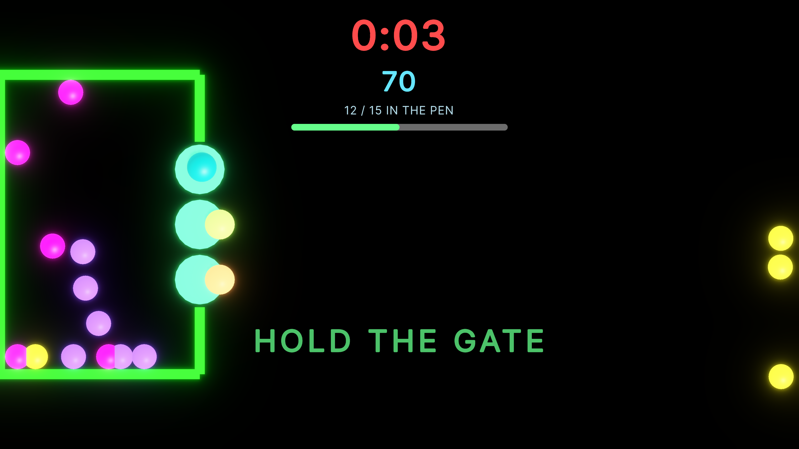

# Herd the Lights

A co-op herding game for 1 to 6 players, designed for a three-wall immersive room. Drive the glowing glimmers into the pen, then seal the gate by standing in it together before time runs out.

Built in Unity 6 in two days as a fast prototype by AL!Z.

**[Play on itch.io](https://code4al1z.itch.io/herd-the-lights)** | **[Watch the playthrough](https://www.youtube.com/watch?v=1AkKk3mqucM)** | **[Level design document](https://claude.ai/artifact/RqgnQV4S6mfvdWFweouKwM)** | **[Portfolio page](https://alizpasztor.com)**

## How to play

- Move the mouse to move your dot. Glimmers run away from it, so get behind them and walk them toward the pen.
- Left click drops a lure that pulls nearby glimmers toward it for a few seconds, then it recharges.
- When the seal phase starts, the gate slots light up. The gate closes only when every player stands in a slot. Hold it for three seconds to end the round.
- Pick 1 to 6 players on the start screen. Teammates beyond the first player are bots standing in for a real group.

| Key | Action |
| --- | --- |
| Mouse | Move and herd |
| Left click | Drop lure |
| 1 to 6, arrow keys | Choose number of players (start screen) |
| Enter or Space | Start |
| R | Replay the round (result screen) |
| N | Next round (result screen) |
| Esc | Back to the menu (result screen), quit (start screen) |
| F11 | Switch between window and fullscreen |

## Rounds and scoring

Three rounds, each adding harder glimmers: Obedient (3 points), Skittish (6 points, panic spreads) and Rebel (9 points, resists and drifts to the edges).

- **Base:** the points of every glimmer in the pen.
- **Seal bonus:** +20% when the gate is sealed.
- **Sweep bonus:** another +20% when every glimmer is in and the gate is sealed.
- **Time bonus:** 1 point per second left when the team seals and ends early.
- **Grades:** S to D from the share of a par score.

Every round has its own top ten for each team size, plus a final total for a full run.

## What is in the project

- **Data-driven content.** Rounds, team size scaling and glimmer types are ScriptableObject assets, so a round can be retuned in the inspector without touching code.
- **Round state machine.** One controller runs the intro, herd, seal and result phases and raises C# events. The HUD, audio and telemetry listen to those events and never call back.
- **Glimmer steering.** Flee, cohesion, separation, wander, edge drift, panic spread and lure attraction, with different weights for each type.
- **Bot teammates.** Lanes, flanking, target hand-off and a blacklist for stuck glimmers. Humans and bots share one player-source interface.
- **UI Toolkit.** The HUD, the score popups and the start menu are built in code with a runtime UI Document.
- **Procedural audio.** Sound cues are synthesised with `AudioClip.Create`, played from pooled audio sources and quantised to the beat. Three music stems layer in as the pen fills and the seal phase starts.
- **Telemetry and bot testing.** Every round is logged to CSV, and a bot-only runner plays all team sizes at 6x speed and writes a summary.
- **Save data.** Leaderboards are stored as JSON in `Application.persistentDataPath`.

The full reasoning, the bot test results and their limits are in the [level design document](https://claude.ai/artifact/RqgnQV4S6mfvdWFweouKwM).

## Open the project

1. Install Unity **6000.3.9f1** (Unity 6) with the Windows build support module.
2. Open the project folder in Unity Hub. The project uses the Universal Render Pipeline and the Input System package.
3. Open the main scene and press Play.

Scripts are grouped by area under `Assets/Scripts/`: `Game` (round flow, scoring, glimmers, pen and gate, leaderboard), `UI` (HUD and start menu), `Audio`, `Players` (mouse input, bots) and `Telemetry` (CSV logging and the bot test runner).

## Playtest tools

Press **F9** in play mode to start or stop automatic bot-only runs across team sizes. Results are written to the saved data folder as `telemetry.csv` and `telemetry_summary.csv`:

- Windows: `%USERPROFILE%\AppData\LocalLow\<company>\<product>\`

Delete `leaderboard.json` in the same folder to reset the scores.

## AI use

Claude was used for planning, code drafts and tuning from the telemetry, and I tested and directed every change. The three music layers (base, drive and tension) were generated with ElevenLabs. All other sounds are synthesised in code. The game icon and the itch.io cover were drawn as SVG code with Claude. The details are in the design document.

## Known issues

- Only the front wall of the room is built. The side walls and a room-view camera are still to do.
- The bots are weak against Skittish and Rebel glimmers, so their numbers are a baseline, not a measure of human difficulty.
- The Windows build is unsigned, so Windows SmartScreen may show a warning (More info, then Run anyway).

## Credits

Made by AL!Z (Aliz Pasztor). Portfolio: [alizpasztor.com](https://alizpasztor.com).
